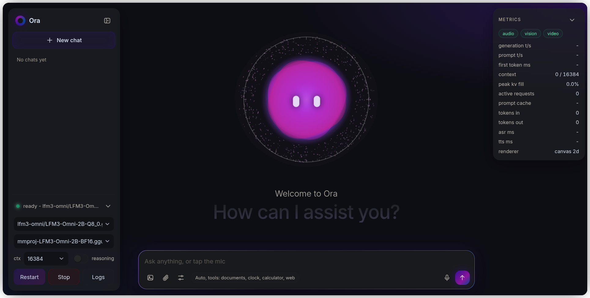

<div align="center">

# Ora

A local voice, image and document chat app for GGUF models, with an orb that reacts to the model.




</div>

**Ora is a demo, not a product.** It shows what the LFM3-Omni-2B model can do: voice, images and documents in
one chat, with tool calls. It has no release process, support or compatibility promises, and you build it yourself.

Ora is one native program that serves a web UI on localhost, keeps chats and documents in SQLite, starts and
stops [`llama-server`](https://github.com/ggml-org/llama.cpp) for you, and renders PDFs to page images for vision
models. Nothing is installed beside it: the web app, SQLite and the PDF renderer are inside the binary (12.5 MB,
Linux x86-64 build).

The orb is a glass sphere with eyes and a dotted shell. Its mood, colour and motion follow the model's load, context
use and the conversation, and its memory of past conversations persists between runs. With speech on, a reply's text
appears sentence by sentence as each one is spoken. PDFs go to the model as
page images, not extracted text, and are rendered in the background so an upload does not stall the chat. Ora
loses to hosted chat apps on model quality and on platforms, see [When not to use this](#when-not-to-use-this).

## Install and privacy

There are no prebuilt binaries: you build Ora yourself, and you supply `llama-server` and a model.

- **First build:** downloads the PDFium library for your machine (about 4 MB) from
  [pdfium-binaries](https://github.com/bblanchon/pdfium-binaries) and checks it against the SHA-256 pinned in
  `ffi/pdfium.lock.json`. This is the only download. `ORA_PDFIUM_LIB` skips it for offline builds.
- **At run time:** the server listens on `127.0.0.1` only, rejects requests with a foreign `Host` or `Origin`
  header, and makes no network requests of its own. It talks to the `llama-server` it started on `127.0.0.1`.
  The one exception is opt-in: the `web` tool group (off unless the config lists it and the page switches it on)
  lets the model fetch pages and search. The `system` group (shell and files in a work folder) asks before every
  action. See [Tools](docs/ARCHITECTURE.md#tools).
- **On disk:** chats, documents and the orb's memory live in the data folder. Deleting it starts fresh.

## Build

Needs Node 24 or newer, `clang`, `ar` (or `llvm-ar`) and `tar`.

```sh
npm install
npm run build
./bin/ora
```

Open http://127.0.0.1:8800, put a `.gguf` model in `~/.config/ora/models/` (created on first start, with a
`README.txt` that explains the layout), then pick it in the engine panel and press Start. A model that handles
images or audio also needs its projector, a `.gguf` with `mmproj` in the name, next to it.

| Platform | State |
|---|---|
| Linux x86-64 | Built and tested. |
| Linux arm64, macOS Apple Silicon, Windows x86-64 | Written, never run. The native code compiles (Windows was cross-compiled with zig). |

`scriptc` has no cross-compile flag, so build on the OS you target. On Windows put an LLVM `clang` and `llvm-ar`
on `PATH`. Settings, the data folder and every environment variable are in
[docs/CONFIGURATION.md](docs/CONFIGURATION.md); how the pieces fit is in [docs/ARCHITECTURE.md](docs/ARCHITECTURE.md).

## Documents

Drop text files or PDFs onto the chat. Text is split into chunks and found again by full-text search (SQLite
FTS5, bm25 ranking), so large files work. PDFs are rendered at 1024, 1536 or 2048 px on the longest side, up to
200 pages. Each question sends the pages whose text matches it (or the pages typed in the box beside the document) to
a vision model. Larger pages help small print and cost more tokens per page. Measured with
a 2B model: printed numbers are read well, values estimated from an unlabelled chart are not.

## When not to use this

| Situation | Use instead | Why |
|---|---|---|
| You want a product you can depend on | A maintained chat app | Ora is a demo of the model and may change or break. |
| You want a hosted or multi-user service | A hosted chat product | Ora serves one user on localhost and has no accounts or TLS. |
| You need a prebuilt binary | A release of llama.cpp's own web UI | Ora is built from source. |
| Your model has no vision support and you need PDF text | A text-extraction tool | Ora sends PDF pages as images; their text is read only to choose which pages to send. |
| You need Windows, macOS or arm64 to work today | Run on Linux x86-64 | The other platforms have never been run. |

## Contributing

Results from macOS, Windows and Linux arm64 are the most useful: whether the build and PDF rendering work there.

```sh
npm install      # also installs the git hooks (lefthook)
npm test         # builds the native library, then runs every test, including a pixel check of PDF rendering
npm run typecheck
npm run build
npm run check    # Biome: format, import order and lint, read-only
npm run check:fix  # the same, applying safe fixes
```

Formatting and linting use [Biome](https://biomejs.dev) 2.6.4, configured in `biome.json` to the existing style:
2-space indent, single quotes, semicolons, trailing commas, line width 140. It covers `src/`, `test/`, `scripts/`
and the root JSON files (not the `.wgsl` shaders or `*.gen.json`). `npm run lint` and `npm run format` run the two
halves alone. The rules `noDescendingSpecificity` and `noImportantStyles` are off: the stylesheet scopes its rules
by element, and `body.no-anim` and the desktop layout rely on `!important`. `npm run check` is not in the hooks.

Before each commit the hooks run the type check and the fast unit tests. Before each push they run the full
suite and a build, about 30 s on Linux x86-64. `scriptc` supports a subset of TypeScript, so run `npm run build`
before relying on a new language feature.

## Docs

- [Configuration](docs/CONFIGURATION.md): config file, environment variables, folders, models.
- [Architecture](docs/ARCHITECTURE.md): the binary, PDF rendering, storage, turns and the HTTP API, voice, the prompt cache, the orb.
- [Third-party components](THIRD_PARTY.md): vendored code, pinned checksums, update steps.

## License

MIT, see [LICENSE](LICENSE). Vendored components keep their own licences, listed in [THIRD_PARTY.md](THIRD_PARTY.md).
